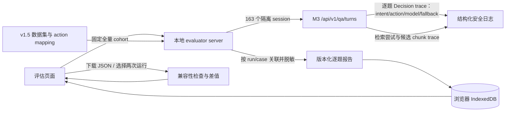

# AI 问答 Decision 与 Recall 评估工作台开发方案

## Goal Capsule

把当前评估页完善为基于本项目测试集的 AI QA 评估工作台：一次运行覆盖 v1.5 的 163 道题，量化 Decision 行为；对 149 道预期作答题单独量化检索与证据 Recall；保存实际生效的模型及配置元数据；在页面中查看、下载并比较已完成的运行。

首期只运行当前配置好的 M3 AI QA API。Jev、Qwen-decision、LLM 等模型由运维在服务端切换后分别运行，页面记录每次实际配置并比较结果。页面内模型选择、自动切换和批量调度留到后续。

### 成功标准

- 一次完整运行对数据集中的 163 个 case 各产生一条 Decision 结果；Decision 分母和 Recall 分母分别呈现。
- Decision 指标有明确、带版本的预期行为映射，显示混淆矩阵、准确率、各类 precision/recall/F1、宏平均 F1、误拒率、误答率和各自支持数。
- Recall 分开显示原始候选 `Recall@12` 与最终证据 `Recall@K`，并显示 Gold 可评分覆盖率、检索执行率和观测覆盖率。
- 每个报告保留足以复核和比较的逐题结果、数据集指纹、指标版本、Decision 实际模型来源和配置身份，不包含凭据或访问令牌。
- 完成报告在同一浏览器重新打开页面后仍可查看；用户可选两次兼容运行比较汇总差值、逐题动作变化和覆盖率变化。
- M3 实跑验证全量调用与 session 清理；任何已有客户 session 不会被复用或关闭。

## Product Contract

### Problem Frame

现有工作台能运行 AI QA 真实链路并算出部分 Recall，但无法完整衡量 Decision，也不能说明一次运行使用了哪种模型或配置。当前保存的 `b2aa89e7-3b41-4a09-8011-35ad33d353d7` 运行调用 149/149 个预期作答 case，Decision 输出为 `answer=72`、`refuse_domain=53`、`clarify=24`；按原始预期作答集合计算，53 次拒答约占 35.6%，但报告没有错误类型评分。14 个预期非作答 case 未运行。

该运行的最终证据 Recall 为 5/270 个 Gold facts，Hit@K 为 2/96 个有 turn observation 的 case。96/149 个 case 有 turn observation，其中只有 35 个有 raw candidate chunk 快照；其余 61 个快照缺失，不能按空结果计零。当前 v1.5 Gold 映射记录有 479/482 条 evidence 映射到 chunk，按 OR/AND 规则 394/394 个 required facts 可评分。线上涉及 7 个知识库，而 Gold 只覆盖其中 3 个；已有观测中 216/220 个最终 chunk 来自未标注语料。因此报告必须同时说明覆盖边界，不应把分数表述成对全部语料的完整 Recall。

数据集中有 163 个 case：149 个 `answer`，其余为 `clarify` 2、`refuse_compliance` 4、`escalate_human` 2、`insufficient_evidence` 1、旧标签 `refuse_or_insufficient_evidence` 5。当前 expected output 均为 draft。标签质量和旧标签含义会限制正式评分范围。

代码状态也影响实施入口：主工作区 `main` 有未提交的 `editor/index.html`、`editor/server.mjs`、`editor/evaluator.mjs` 等改动；M3 evaluator 在独立的 `codex/m3-ragflow-eval-deploy` 工作区，尚未并入主线。实施应从 M3 部署分支或其明确后继分支开始，先复核差异和运行记录；保留主工作区已有 WIP。后端观测改动属于 `/Users/mac/work/ai-support-platform` 的独立交付。

### Requirements

**R1 — 完整且可复核的运行**

- 启动一次全量运行时，Decision cohort 固定为当前数据集所有 163 个 case；Recall cohort 是 149 个 `answer` case。界面明确显示这两个分母，不提供会悄悄缩小 Decision cohort 的 case cap。
- 按稳定顺序执行，并分别记录 API 调用结果、Decision 观测、检索是否执行、candidate 观测、final evidence 观测和 session 清理结果。
- 每个 case 有显式状态。API 失败、Decision 缺失、早退未检索、有效空候选、日志缺失和成功检索是不同状态。
- 完成运行要求全部 163 个 case 都有 Decision 输出、元数据快照完整且报告成功保存。否则保留 partial/failed 报告，展示完成数和失败原因；partial 报告不可作为完整运行基线。

**R2 — Decision 评分契约**

- 采用有版本的 case 级 expected-action 映射。首批直接映射：`answer → answer`、`clarify → clarify`、`refuse_compliance → compliance_block`、`escalate_human → escalate_human`、`insufficient_evidence → insufficient_evidence`。
- `refuse_domain` 是域外拒答动作，不等同于合规拒答；预期作答 case 得到 `refuse_domain` 时计为错误，并纳入误拒统计。预期合规拒答的正确动作是 `compliance_block`。
- 对 5 个旧 `refuse_or_insufficient_evidence` case 逐题审定可接受动作，再写入版本化映射。未审定的 case 保留在逐题结果和总运行数中，但排除在 accuracy、混淆矩阵和其他需要单一真值的指标之外，并显示未评分数量。
- 汇总报告包括 scoreable accuracy、混淆矩阵、每类 precision/recall/F1、macro F1、每类支持数、预期作答误拒率、预期非作答误答率、Decision 观测覆盖率及可评分标签覆盖率。样本量小的类别同时显示分母，不设自动通过阈值。
- expected output 当前是 draft，因此评分标为 provisional，并显示标注审核状态。指标的主对象是最终 `Decision.action`；现有数据没有 expected intent，不计算 intent accuracy。若预期作答 case 的观测 intent 为 `other`，单独作为诊断项。

**R3 — Recall 与语料覆盖**

- 预期非作答的 14 个 case 不进入 Recall 分母。预期作答 case 因 Decision 早退而未进入检索时，Recall 标记为 `not retrieved`，不伪装成检索 miss；同时展示 149 个 answer case 中检索实际执行数。
- 对检索已执行且 Gold 可评分的 case，分别计算 raw candidate chunk `Recall@12` / `Hit@12` 和最终证据 `Recall@K` / `Hit@K`。计算按数据集现有 OR/AND Gold 组规则执行，分子、分母和 K 均写入报告。
- Gold 不可映射的 evidence 或无有效 required group 的 fact 标为 unscorable，不按 miss 处理。分别展示 evidence 行映射覆盖率和 required-fact 可评分覆盖率。
- raw candidate 的有效空数组是观测到的零结果；没有 observation、没有 chunk ID 或旧 schema 无法解析是 unavailable。candidate 覆盖率与 Recall 分数分开展示，不能把缺失快照填成空数组。
- 显示 Gold 覆盖了多少知识库/语料，以及候选和最终 chunk 中有多少来自已标注、未标注语料。未标注语料不纳入 Gold Recall 断言；headline 标注为 Gold-covered corpus 指标，不能宣称覆盖全部线上语料。

**R4 — Decision 模型与运行元数据**

- 每次运行记录数据集版本及 digest、expected-action mapping 版本及 digest、report/metric schema、K、评估器版本、M3 build SHA、Decision mode、配置 family/preference、classifier chain、稳定 model ID、每题实际 classifier source、fallback 状态/原因类别和配置 fingerprint。
- 模型身份应来自服务端实际生效的 per-turn trace；不能只依据 UI 输入或进程启动时环境变量推断。若 `auto`/resilient chain 在运行期间发生 fallback，报告显示各 source 计数并将运行标为 mixed provider；若配置变化，逐题记录并标记 mixed config。
- 元数据不可用时，记录明确的 unavailable reason，并将 Decision 运行标为不可归因，不允许用猜测值补齐。报告不保存 API key、JWT、refresh token、密码、完整授权头或带凭据 URL。
- 首期页面不负责切换服务端模型，也不保证后端当前已具备每个候选 provider。用户在服务端配置好模型后分别运行，再在页面比较结果。

**R5 — 报告留存与运行比较**

- 原始逐题结果是报告的权威数据；汇总指标可由同一报告 schema 重算。报告使用稳定 `run_id` 和显式 schema version。
- 首期在浏览器 IndexedDB 保存 sanitized report 与运行索引，支持刷新后查看、下载 JSON 和删除历史。建议默认保留最近 50 次运行，提供导出备份；不把报告放进保存 API 凭据的 localStorage，也不新增未认证的服务端报告读写 API。历史只在当前浏览器可见，清除浏览器数据前需导出备份。
- 比较两次已完成运行时展示各自模型配置、Decision 指标变化、逐题动作变化、Recall 变化和所有分母/覆盖率。
- 硬兼容条件：case ID/数据集 digest、expected-action mapping digest、指标 schema、K 和 cohort 一致。硬条件不同则阻止 headline delta，或明确标为共同 case 子集比较。
- M3 build、Decision mode、语料/index snapshot、标注审核状态不同属于重要混杂因素：允许查看观测差异，但醒目标记，不能描述为纯模型因果对比。要做模型单变量比较，操作者应保持这些条件一致，每次只改变服务端模型配置。
- 仅完整运行可作为默认比较基线；partial 报告可打开和下载，但需单独说明，不能伪装成完整 cohort。

**R6 — M3 会话与失败安全**

- 只调用 `/api/v1/qa/turns` 配置目标；使用专用 evaluation identity 和每次运行隔离的 session。复用现有所有权 preflight，无法证明 session 属于评估器时 fail closed。
- 运行记录包含 session 创建、关闭和清理状态。不能复用、关闭或写入客户 session；取消运行时停止新请求并尽力清理已创建的评估 session。
- QA turn 是有副作用的 POST。除非 API 支持并启用幂等 request ID，否则不自动重试已发送的 case，避免重复交付。错误报告应保留已完成 case，允许用户明确重新开始一轮。

### Scope Boundaries

**首期包括**：固定 M3 AI QA 目标、163 case Decision 全量运行、149 answer case Recall、预期动作映射与 provisional 标识、结构化后端 Decision/retrieval trace、报告 schema、IndexedDB 历史、JSON 下载、两次完整运行比较、逐题详情与会话隔离。

**首期不包括**：页面内切换 Jev/Qwen/LLM、一次操作调度多个 provider、自动切换后端配置、增加新的 Decision provider、服务端共享报告数据库、全语料自动 Gold 标注、基于阈值自动判定上线/回滚。后续可以在本期元数据和 report schema 稳定后再规划模型选择与 batch runner。

### Key Decisions

- 首期采用“记录每次运行的模型/配置并比较已完成运行”；模型切换留在服务端人工操作。 (session-settled: user-directed — chosen over first-release model selector and batch execution: keeps first release focused on attribution and saved-run comparison.)
- 报告先存在浏览器 IndexedDB，避免为无认证的 LAN evaluator 新增共享报告 API；JSON 下载用于外部备份。
- Decision trace 由后端逐题产生，包含 early exit 路径；评估器不从配置偏好猜测实际 model source。
- 评分以当前已审定/映射的 case 为分母，并暴露 draft 与 legacy 缺口；不通过强制映射隐藏不确定性。
- Decision correctness 与 Retrieval Recall 是两组不同指标和分母；早退不作为 Recall=0。

## Planning Contract

### Key Technical Decisions (KTD)

1. **首期对比边界**：已由用户选定，保留运行元数据并比较运行；无页面 provider selector 或批量调度。
2. **动作标签**：遵循后端实际动作枚举；`refuse_compliance` 对应 `compliance_block`，不对应 `refuse_domain`。
3. **标签未完成**：逐题结果全量保留；只有明确映射且标签状态可见的 case 进入相应 scoreable denominator。旧标签不自动猜测。
4. **持久化**：浏览器 IndexedDB、最多默认 50 份、JSON 导出，不新增 server-side report API。
5. **部署起点**：先比较 dirty `main` 与 M3 部署 worktree，再从部署分支或其后继分支实现 UI/evaluator；后端 trace 独立 PR；不覆盖任何现有未提交文件。

### High-Level Technical Design

API telemetry 应可由评估器按 run/case correlation ID 关联，覆盖所有 Decision 分支和早退分支。若当前容器日志采集机制仍是主路径，沿用其读取方式，但使用稳定的结构化事件 schema，不依赖自由文本正则。逐题报告只保存去标识化 correlation ID，不保存原始 token、auth header 或不必要的用户/session 标识。

### Implementation Units

**U0 — 数据集与 Decision 评分契约**

- 新增版本化 expected-action sidecar/manifest；确认直接映射，逐题处理 5 个 legacy case；记录标注状态和映射版本/digest。
- 更新数据集校验器，检查 163 个 case 均可归类为 mapped、unscored 或明确无标签，不允许静默遗漏；验证 answer cohort 为 149。
- 交付：可版本化的 case/action crosswalk、数据集 fingerprint 规则和报告中显示的 provisional 状态。
- 验收：误把 `refuse_compliance` 映射到 `refuse_domain` 会被校验/契约测试捕获；未审定 legacy case 进入 unscored denominator 说明。

**U1 — 后端 Decision 与检索逐题 trace（ai-support-platform PR）**

- 在 Decision 执行点产生结构化 per-turn trace，覆盖 shadow/enforce/off 适用分支、fallback 和 early exit；包含 intent、action、mode、action reason/安全 flags、实际 classifier/model ID、fallback source 和安全配置 fingerprint。
- 在每条实际检索分支采集 raw candidate chunk IDs 与顺序；记录“未检索”“有效空结果”“观测不可用”不同状态。不得只在 `knowledge_or_product_qa` 单一分支采集。
- 加入稳定 correlation ID 与 build SHA；确认日志字段不包含请求凭据、prompt 中个人数据或完整授权信息。模型和配置字段采用 allowlist。
- 交付：结构化 trace schema、早退/多 provider fallback 集成测试、候选分支测试及部署说明。
- 验收：同一个 case 可关联 Decision 和 retrieval trace；Decision early exit 有 Decision trace 但明确没有 retrieval trace；fallback 时能识别实际 source。

**U2 — Evaluator 全量 cohort、report schema 与指标**

- 从 M3 evaluator 分支/后继分支实现；保留现有真实 API 调用、session preflight、session cleanup 与逐条进度流。
- 删除 Decision 的 answer-only 过滤和可能缩小完整评估 cohort 的 case cap；Decision 跑完 163 个 case，Recall 只聚合 149 个 answer case。
- 扩展 `editor/evaluator.mjs` 或拆出纯指标模块：crosswalk、confusion matrix、PR/F1、false refusal/answer、raw candidate `Recall@12`、final evidence `Recall@K`、Gold OR/AND 规则、coverage 和 unavailable state。
- 生成版本化逐题 report：case 结果、完整性状态、safe run metadata、source coverage、metrics 和报告 digest。只有所有 case Decision 输出齐全且保存成功才标 complete。
- 验收：单元 fixture 覆盖动作映射、macro F1、拒答/误答、OR/AND evidence、未映射 Gold、空候选与缺失观测、早退未检索、mixed provider/config。

**U3 — 页面运行体验、历史与两次运行比较**

- 运行面板显示 `Decision 0/163`、`Recall 0/149`、运行阶段、API/Decision/observation 三种进度以及 cancel/partial 状态；隐藏 provider selector 和 batch 控制。
- 单次报告显示 Decision、Recall、Gold coverage、candidate coverage、标注审核状态、模型元数据和逐题详情。所有分数都同时显示 numerator/denominator。
- 使用 IndexedDB adapter 保存 report；增加刷新恢复、下载 JSON、删除单次/全部历史和保留上限提示。报告与凭据 profile 存储分开。
- 增加选择两个完成运行的 compare view，先显示硬兼容结果与 build/mode/corpus/config 差异，再展示汇总 deltas 与逐题变化。模型配置差异是比较信息，不纳入硬兼容 key。
- 验收：刷新页面后记录仍在；不兼容 run 不显示无标签的 headline delta；模型变化时元数据和 per-case action change 可见；历史存储不写入 localStorage 凭据区。

**U4 — 集成、M3 实跑与交付**

- 先合入并部署 U1 telemetry，再部署 evaluator 页面；确认 M3 后端 build 与结构化事件 schema 一致。
- 使用专用 evaluation identity 跑完整 163 case。检查结果完整性、两组 cohort 分母、session 清理、候选覆盖及每题 model source。将报告导出作为验收材料，不含凭据。
- 至少在相同数据集、相同 backend build/mode/index 下，通过服务端人工切换两种可用 Decision 配置各跑一次，验证可比较和差值归因；本单元不增加页面切换/批量功能。
- 验收：刷新后能打开两次运行并比较；任何一题缺少 Decision、trace 配置无法识别、session 清理失败或报告保存失败都能清楚呈现，不被标成成功完整 run。

### Dependencies and Order

U0 与 U1 可并行；U2 依赖 U0 的 score mapping 和 U1 的 trace contract；U3 依赖 report schema；U4 依赖 U1–U3。PR 顺序建议：数据映射/校验器 → 后端 telemetry → evaluator/report schema → UI/IndexedDB/compare → M3 集成验收。

## Verification Contract

本方案只定义后续开发的验证要求；本轮没有改动 evaluator/backend 源码，也没有新增或运行测试。

### Automated checks to add with implementation

- 数据集校验：163 case、149 answer cohort、expected-action mapping 版本和 legacy/unscored 显式状态。
- Node 单测：行为映射与指标公式；边界值的 precision/recall/F1；候选空数组 vs 缺失观测；早退；Gold OR/AND 组；未映射 evidence；报告 schema/digest；compatibility key 与混杂因素提示。
- 后端 Go 测试：早退路径仍记录 Decision trace；正常检索路径记录 candidate trace；各 retrieval 分支覆盖；fallback 记录实际 source；结构化日志不包含 credentials。
- 页面/IndexedDB 验证：写入、刷新读取、下载一致、删除、容量/保留上限、两次完整报告 compare、partial/incompatible run 被正确限制。

### M3 acceptance run

1. Preflight 确认身份、Decision mode、元数据来源、dataset digest 与 evaluation session ownership；故意保留一个 unrelated 客户 session，验证 preflight 不触碰它。
2. 完成一次全量运行：163/163 Decision；Recall eligible 149；逐项核对 API errors、early exits、retrieval attempted、candidate trace、有观测空结果、observation unavailable 和 cleanup 状态。
3. 检查 `refuse_compliance → compliance_block`；检查未审定 legacy case 的显示和 scoreability；对照人工抽样核验混淆矩阵和至少一条 per-case Recall 计算。
4. 运行期间抽查模型来源及 fallback；前后配置变化必须产生 mixed config 标记。检查 JSON 中无 credentials、JWT、refresh token、授权头或带秘密的 URL。
5. 刷新页面后验证历史；同条件下第二个可用模型运行和首个报告比较。确认 Recall 分差旁显示 candidate/Gold coverage 与 build/mode/index 元数据，变化不被误述为单一模型因果。

## Definition of Done

- [ ] 163 个 case 的 Decision cohort 在 UI 和报告一致；149 个 answer case 单独作为 Recall cohort。
- [ ] 所有逐题 Decision 输出有实际模型/source/mode 归因，或以显式 unavailable 原因阻止完整可比状态。
- [ ] Decision direct mappings、legacy unscored 状态、draft 标注 provisional 状态和支持数均可见。
- [ ] Recall 层级、分母、Gold mapping/scorability、候选 observation coverage、未检索/空结果/缺失状态互不混淆。
- [ ] Raw candidate 采集覆盖所有相关 retrieval 分支，`intent=other` 可用于诊断预期 answer 被错分的情况。
- [ ] 可在 IndexedDB 中保留并恢复报告，下载 JSON，比较两次兼容完成运行；元数据差异与兼容限制准确显示。
- [ ] session isolation、cleanup、取消和 partial failure 验收通过；真实客户 session 未被触碰。
- [ ] 自动检查及 M3 acceptance run 通过；计划中定义的安全脱敏规则经报告检查确认。
- [ ] 开发基于正确的 M3 evaluator 后继工作区进行，主工作区既有未提交 WIP 未被覆盖。

## Risks and Open Dependencies

| 风险/依赖 | 影响 | 应对 |
| --- | --- | --- |
| 所有 expected output 仍为 draft，5 个旧标签语义不清 | Decision 指标可能量化错误标准 | 发布前由数据集负责人审定映射；未完成时只发布 provisional/partial label score，逐题保留未评分原因 |
| 当前 per-turn trace 没有 `intent` 和实际 fallback source，early exit observation 不完整 | 结果无法可靠归因；漏掉 candidate 会污染 Recall | U1 定义结构化 trace，缺数据明确标 unavailable；部署后再开放完整 M3 运行 |
| Gold 只覆盖部分线上语料 | Recall 不能代表全部 7 个库 | 将 Gold-covered recall 和 Gold/语料覆盖并列显示，不给全库 Recall 标签 |
| `auto`/resilient chain 或运行期间配置变更 | 两次报告可能不是单一模型对比 | 逐题记录有效 source 和 config fingerprint，标记 mixed provider/config，并在比较页提示混杂因素 |
| 当前部署代码与 dirty main 不同 | 误从错误版本开发会丢失可运行 M3 链路或覆盖 WIP | 开工时复核两个 worktree、report schema 和目标分支；保留现有未提交文件 |
| 全量运行约需十余分钟且 API POST 有副作用 | 超时或重试可能重复交付 | 流式进度、partial 保存、独立 session、默认不自动重试已发送 case；只有有幂等保证时才另行设计重试 |
| IndexedDB 只属于当前浏览器 | 换浏览器/清站点数据可能丢失比较历史 | JSON 导出备份，页面显示本地留存范围与容量策略；共享历史作为后续需求再立项 |
| 后端版本/运行环境变化与模型一起变化 | comparison 不能隔离模型变量 | 比较页显示 build/mode/index 等条件；模型-only 实验要求这些因素固定 |

## Research and Source Notes

- 当前数据集与部署 evaluator：M3 worktree `/Users/mac/work/rag-eval-dataset-m3-deploy` 的 `datasets/v1.5/`、`editor/evaluator.mjs`、`editor/index.html`、`editor/server.mjs`、`reports/v1.5-ai-qa-recall.json`。
- Decision 动作定义及请求路径：`/Users/mac/work/ai-support-platform/backend/internal/decision/exits.go`、`backend/internal/api/qa_turns.go`、`backend/internal/api/qa_turn_observation.go`、`backend/internal/intentdetect/decision_classifier.go`。
- 当前本地工作区含未提交评估器草稿；实施前复核其与部署分支的差异，但本计划文件不改动这些源文件。
