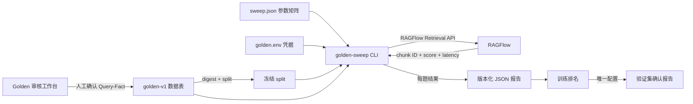

# Golden Dataset 长期建设计划

## Goal Capsule

把 `datasets/golden-v1` 做成可长期维护、可冻结、可复现的 RAG 参数调优数据集。人工审核 Query 与必需 Fact 的关系，复用已验证的 Fact–Evidence–Chunk 映射，批量调用 RAGFlow Retrieval API，以 Fact Recall 和 Complete@12 为主目标，以 MRR 和延迟为次级目标，并在独立验证集上确认最终参数。

首期不改动已发布的 `v1.4` 和 `v1.5`，不把报告写回 Golden 数据，不在浏览器里管理参数扫描。审核继续在 Golden 工作台完成。参数扫描使用本机 CLI 和版本化 JSON 报告。

### 成功标准

- 每条 Query 的必需 Fact 关系都有审核状态。训练集参数选择只使用 `approved` 关系。
- `query_facts`、Fact 到 Chunk 的映射、训练集和验证集切分都有稳定 digest。报告能指出运行时使用的精确快照。
- 验证集按真实分组隔离。同场景或共享必需 Chunk 的 Query 不跨 train 与 validation。
- 一次扫描能按配置矩阵调用 Retrieval API，保存每题排名、命中、延迟、错误和汇总指标。
- Fact Recall@12、Complete@12、MRR@12、延迟 p50/p95 都有分子、分母、样本数和失败数。
- 参数选择只依据训练集。最终参数只在冻结的验证集上运行一次，验证报告与训练排名分开保存。
- 当前机器已有的 RAGFlow 凭据只从 `~/.config/rag-eval-dataset/golden.env` 读取。报告和扫描配置不保存 API key。

## Product Contract

### Problem Frame

仓库已有完整的 Golden 数据图。`datasets/golden-v1` 有 163 条 Query、462 条 Fact、483 条 Evidence、317 个 Chunk、719 条 Query–Fact 关系。关系表已覆盖 `required`、`required_any`、`optional`、`forbidden`、OR 和 AND。`scripts/lib/golden.mjs:421` 的 `assessRecall` 已实现集合召回、评分组和不可评分 Gold。

但当前数据还不能直接支持长期参数实验。Query–Fact 关系没有审核状态。`datasets/golden-v1/MANIFEST.json` 只有基础文件清单。没有训练集与验证集切分。Golden 工作台的单题试检索只发送 `question`、`dataset_ids`、`top_k`、`page_size`，见 `editor/golden-server.mjs:243`。批量扫描、指标排名、验证集确认和报告留痕都不存在。

当前 163 条 Query 都是 canonical，没有真实变体。按 `parent_query_id` 切分等于按单题切分。按场景切分会得到 23 组，其中最大组 15 题。按共享必需 Fact 切分会得到 88 组，其中最大组 19 题。按共享必需 Chunk 切分会得到一个 98 题的大连通分量。验证集必须按场景或共享 Fact 分组隔离，不能只按 Query ID。

仓库中的 `v1.4` 和 `v1.5` 是已发布版本，校验器按固定文件集读取它们。Golden 数据要新增自己的 manifest 注册项，不能塞进根 `MANIFEST.json` 的 `versions`，否则 `scripts/lib/dataset.mjs:29` 的 `loadDataset` 会误读。

### Requirements

**R1 — 人工审核可追踪**

- 为 `query_facts.jsonl` 增加 `review_status`、`reviewer`、`reviewed_at`、`review_note`。初始状态为 `pending`，不把 v1.5 继承关系默认标成 `approved`。
- 为 Fact 到 Chunk 的映射增加审核记录，记录 Fact、证据 ID 集合、Chunk ID 集合、operator 和映射 digest。集合变更需要新审核记录。
- 工作台显示待审核关系、当前 scoring group、Evidence 摘录和来源 Chunk。审核动作只改变审核字段和状态，不改变评分语义。
- 训练集选择使用 `review_status=approved` 的 Query–Fact 关系。未审核关系留在数据里，但不进入正式扫描分母。

**R2 — 数据集快照与切分**

- Golden manifest 升级到 schema v2，记录内容、标签、映射 digest，以及已冻结的 split 列表。
- 新增 split 文件，记录 dataset digest、分组方法、随机种子、比例、冻结状态和逐题分配。
- 验证集按场景分组，按共享 Fact 和共享 Chunk 做泄漏检查。同一场景或共享必需 Chunk 的 Query 不得跨 split。
- 冻结后修改 Query–Fact 或映射关系会使 split 失效。运行器拒绝使用 digest 不匹配的 split。
- 根 manifest 增加独立的 `golden_versions` 注册，不改变现有 `versions` 的语义。

**R3 — 参数矩阵执行**

- 新增 sweep 配置文件，声明 dataset、split、检索 dataset IDs、参数组合、重复次数、并发、超时、评分 K 和指标版本。配置文件不含凭据。
- 从 `~/.config/rag-eval-dataset/golden.env` 读取 RAGFlow 地址和 key，控制台只显示 host。
- Current RAGFlow Retrieval API accepts `question`、`dataset_ids`、`document_ids`、`page`、`page_size`、`similarity_threshold`、`vector_similarity_weight`、`top_k`、`rerank_id`、`keyword`、`highlight`、`cross_languages`、`metadata_condition`、`use_kg`、`toc_enhance`。首期开放 `page_size`、`similarity_threshold`、`vector_similarity_weight`、`top_k`、`rerank_id`、`keyword`、`cross_languages`。未知字段在配置边界直接拒绝。
- 每题保存请求参数摘要、响应 chunk ID 与分数、客户端耗时、错误和重试次数。Retrieval 请求失败不做静默重试。
- 运行器支持 `--split train` 和 `--split validation`。验证集运行要求 split 已冻结，且配置 digest 等于训练排名选定的配置。

**R4 — 指标与排名**

- 使用 `assessRecall` 的评分组语义。Fact Recall@12 为每题 `hit_total/scorable_total` 的宏平均，同时给出 micro recall。
- Complete@12 要求所有必需单项和所有 `required_any` 组都满足。不可评分的必需项计为未完成，不得因为 Gold 缺失而加分。
- MRR@12 使用排名感知匹配。OR Fact 取任一 Evidence 最早命中排名，AND Fact 取各 Evidence 最早命中排名的最大值，任选组取成员最小值。未命中计零。
- 延迟记录 p50、p95、mean、样本数和失败数。重复运行要记录 spread。差距小于 spread 时，排名报告标为不确定。
- 排名先按 Complete@12，再按 Fact Recall@12，再按 MRR@12、p50 延迟。主指标差距超过重复运行 spread 才有资格进入验证集。

**R5 — 报告与验证**

- 每个参数配置产生独立 JSON 报告，带 schema version、run ID、dataset digest、mapping digest、split digest、config digest、RAGFlow host、corpus snapshot、evaluator version 和 report digest。
- 报告经脱敏扫描后才写盘，不保存 Authorization header、API key、JWT、密码或带凭据 URL。
- 汇总报告列出每个配置的主指标、次级指标、分母、失败数和不确定性标记。
- 验证报告单独保存。只有数据集、映射、split 都冻结，且训练阶段已选定唯一配置，才允许运行。

### Scope Boundaries

**首期包括**：审核状态和映射审核记录、Golden manifest v2、冻结 split、CLI sweep runner、版本化报告、主指标与次级指标、训练排名、验证确认。

**首期不包括**：工作台批量参数 UI、共享报告数据库、自动上线、全语料自动 Gold 标注、Decision 动作评分、跨机器任务调度、Retrieval API 之外的生成链路评分。

### Key Decisions

- 保持七张 Golden JSONL 表为唯一数据主体。审核、切分、sweep 使用 sidecar 文件。
- 先做 CLI。现有 Golden 工作台只适合单题审核和试检索，批量运行使用本机文件报告。
- 旧 `query_facts` 继承关系的审核状态从 `pending` 开始。正式训练分母不把继承关系当成已审核真值。
- 验证集按场景分组，并额外检查共享 Fact 和 Chunk 泄漏。
- 验证集不是模型选择集。训练阶段必须锁定一个配置，验证阶段只做确认。

## Planning Contract

### Key Technical Decisions (KTD)

1. **数据主体**：七张 Golden JSONL 表不变，新增审核字段、映射审核文件和 split 文件。
2. **注册位置**：根 manifest 新增 `golden_versions`，不复用 `versions`。
3. **切分粒度**：场景分组最小切 35 题左右；共享 Fact 和 Chunk 只做泄漏约束，不直接作为分组键。
4. **凭据边界**：CLI 读取现有 `golden.env`，报告和 sweep 配置只保存 host 与非敏感参数。
5. **评分来源**：集合指标复用 `assessRecall`，排名指标新增纯函数，不改变 Gold 语义。
6. **验证纪律**：训练选参，验证确认。验证失败不得回头改训练配置后重跑同一验证集。

### High-Level Technical Design



### Implementation Units

**P0 — 审核状态与快照契约**

- Depends on: none
- Files:
  - `scripts/lib/golden.mjs`
  - `scripts/lib/dataset.mjs`
  - `datasets/golden-v1/MANIFEST.json`
  - `datasets/golden-v1/query_facts.jsonl`
  - `datasets/golden-v1/README.md`
  - `docs/golden-dataset-review-tool.md`
  - `test/golden.test.mjs`
- Build: extend relation state and manifest with review status and digests. Add validation for review fields and digest integrity. Add a migration that seeds inherited relations as `pending`.
- Result: a Golden snapshot has reviewable labels and can be identified by stable digests.
- Verification:
  - Unit: relation status is valid, imported rows are `pending`, digest changes when labels or mapping change.
  - Live: open the Golden state API and inspect one Query with its review fields.
  - Perf: not applicable. This unit makes no network calls.

**P1 — 冻结 split 与工作台审核动作**

- Depends on: P0
- Files:
  - `scripts/lib/golden.mjs`
  - `scripts/golden-sweep.mjs`
  - `editor/golden/api.js`
  - `editor/golden/app.js`
  - `editor/golden-server.mjs`
  - `datasets/golden-v1/splits/`
  - `test/golden.test.mjs`
- Build: add grouped split builder, leak checks, freeze command, and relation review endpoints. Use the scenario group as the split key. Validate that no scenario or shared required chunk crosses train and validation.
- Result: an operator can review Query–Fact relations and freeze a split that is safe for validation.
- Verification:
  - Unit: split counts are about 128 and 35; grouped split has zero scenario leakage; shared-chunk leakage is reported and rejected when present.
  - Live: approve one relation in the workbench, read it back after reload, and freeze a split through the CLI.
  - Perf: not applicable. This unit makes no RAGFlow sweep calls.

**P2 — Retrieval sweep runner**

- Depends on: P0, P1
- Files:
  - `scripts/golden-sweep.mjs`
  - `scripts/lib/golden-eval.mjs`
  - `package.json`
  - `test/golden-sweep.test.mjs`
  - `reports/golden-sweeps/`
- Build: add config parsing, credential loading, RAGFlow request execution, per-case raw results, latency capture, secret scan, and file reports. Reject unknown RAGFlow parameters at the config boundary.
- Result: one command runs a parameter matrix over a frozen split and writes auditable reports.
- Verification:
  - Unit: config validation rejects unknown fields and credentials; a fake Retrieval response produces a complete report; failures keep per-case status.
  - Live: run a two-query smoke sweep against the configured RAGFlow host and verify the report contains no secrets.
  - Perf: record request p50 and p95 from the smoke run. No threshold yet. Establish baseline spread with three repeats.

**P3 — 指标、排名与验证确认**

- Depends on: P2
- Files:
  - `scripts/lib/golden-eval.mjs`
  - `scripts/golden-sweep.mjs`
  - `test/golden-sweep.test.mjs`
  - `docs/golden-dataset-review-tool.md`
- Build: add Fact Recall, Complete@12, MRR@12, latency aggregation, ranking, uncertainty marker, and validation-only run gate. Keep validation reports separate from training reports.
- Result: training selects one parameter set; validation confirms it on the frozen holdout.
- Verification:
  - Unit: OR and AND rank rules, unscorable Gold, complete semantics, empty result, MRR zero, latency percentiles, and repeat spread marker.
  - Live: run ranking on the P2 smoke report, then run a validation report with the winning config.
  - Perf: compare p50 across three repeats and keep the spread in the ranking report.

## Dependencies and Order

P0 is the scaffold. P1 depends on P0. P2 depends on P0 and P1. P3 depends on P2. Do not run validation until all labels, mapping, and split are frozen and one training configuration is selected.

## Verification Contract

The commands below are written for the implementation. This round only creates the plan and does not change evaluation code or dataset files.

```bash
npm run lint
npm run validate
node --test test
node scripts/golden-sweep.mjs split --dataset golden-v1 --seed 42 --validation-ratio 0.2
node scripts/golden-sweep.mjs run --config sweeps/sweep-v1.json --split train
node scripts/golden-sweep.mjs rank --reports reports/golden-sweeps/sweep-v1
node scripts/golden-sweep.mjs run --config sweeps/sweep-v1.json --split validation --confirm
```

### Prototype evidence

A throwaway split comparison was run against current `golden-v1` data. The scratch script is at `/private/var/folders/vq/fzgtsy0j1xz00phbgttnlx1r0000gn/T/opencode/golden-split-prototype.mjs` and is not part of the repository.

| Group key | Groups | Largest group | Validation queries at 20% |
| --- | ---: | ---: | ---: |
| Query root | 163 | 1 | 33 |
| Scenario | 23 | 15 | 35 |
| Shared required Fact | 88 | 19 | 33 |
| Shared required Chunk | 39 | 98 | 34 |

Scenario grouping is the smallest decision. Shared-chunk grouping is too coarse for a 163-query set because one group contains 98 queries. Shared-fact grouping is useful as a leakage check, not as the primary partition.

## Definition of Done

- [ ] Query–Fact relations and Fact–Chunk mapping have review records and digests.
- [ ] A frozen split exists with zero scenario leakage and documented shared-Fact and shared-Chunk checks.
- [ ] A sweep config can express the supported RAGFlow Retrieval parameters and is rejected when it contains credentials or unknown fields.
- [ ] A smoke sweep produces per-query reports with rankings, errors, latency, and no secrets.
- [ ] Fact Recall@12, Complete@12, MRR@12, latency p50/p95, sample counts, failures, and spread are reported.
- [ ] Training ranking selects one configuration. Validation runs only after freeze and confirmation.
- [ ] `npm run lint`, `npm run validate`, and `node --test test` pass.

## Risks and Open Dependencies

| Risk or dependency | Impact | Response |
| --- | --- | --- |
| 186 Facts are still `draft` inherited from v1.5 | Gating on entity status would erase most evaluation labels | Gate formal runs on reviewed Query–Fact relations and mapping review, not the inherited Fact `status` field. |
| Shared Chunk group contains 98 queries | Random validation split leaks the same gold evidence across train and validation | Use scenario groups for splitting and reject any split with shared required Chunk across sides. |
| RAGFlow corpus may drift from chunk snapshots | Gold chunk IDs may stop matching live chunks | Record corpus snapshot ID or document count digest in every report. Refresh mapping in a new dataset version. |
| Retrieval API parameters vary by deployment | Sweep config may be rejected upstream | Keep an allowlist from current RAGFlow docs and fail at config validation with the field name. |
| Complete@12 penalizes unscorable Gold | Some otherwise good configs may look worse | Report unscorable count next to Complete@12. Do not treat unscorable as a hit. |
| Repeated runs have network noise | Small score gaps may be wrong | Store repeats and spread. Mark gaps inside spread as uncertain before validation. |
| Validation can become a tuning set | Final number loses meaning | Freeze split and selected config. Do not rerun validation after changing parameters. |

## Principles Applied

- **Foundational Thinking** changed the design to define relation review, split, sweep, and report records before commands.
- **Laziness Protocol** kept the seven-table data body and added only the sidecars needed for review, split, and reporting.
- **Build the Lever** moved parameter sweeps into one rerunnable CLI instead of manual API calls.
- **Model the Domain** turned review and split state into explicit records instead of scattered booleans.
- **Boundary Discipline** put config, RAGFlow parameter, credential, and report validation at the CLI and network edges.
- **Type System Discipline** kept semantic IDs, digests, phases, and review states explicit in JSON schemas.
- **Prove It Works** requires unit checks, a live two-query sweep, and direct inspection of generated reports.
- **Sequence Work Into Verifiable Units** ordered the PRs as P0 through P3 with a check at each boundary.
- **Explain the Number** requires repeats, spread, corpus identity, numerator, denominator, and failure counts with every score.
- **Unslop** shaped this document to use literal sentences and one idea per sentence.

## Open product decisions

These decisions do not block P0. They must be settled before the first formal validation run.

1. Who is allowed to approve Query–Fact relations and mapping changes?
2. What corpus snapshot identifier does the deployed RAGFlow instance expose?
3. Should `document_ids` and `metadata_condition` enter the sweep matrix, or stay fixed for deployment reasons?
4. What repeat count and metric gap count as a real win for this corpus?
5. Does a rejected relation mean "not required for this Query" or "removed from this dataset version"?
